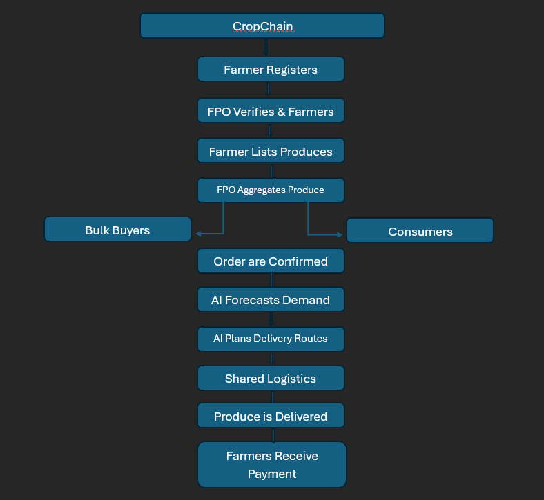

# Smart India Hackathon Workshop
# Date:24/11/2026
## Reference Number:26008892
## Name:Anli Jovita C

## Problem Title
SIH 26033: Multiple intermediaries reduce farmers earnings and increase consumer prices.

## Problem Creater's Organization
Ministry of Consumer Affairs, Food & Public Distribution

## Theme
Agriculture, FoodTech & Rural Development

## Problem Description
Expected Solution: Create a digital marketplace that:

• Connects farmers/FPOs directly with consumers and bulk buyers.
• Provides logistics support.
• Uses AI for demand forecasting and route optimization.

Benefits:

• Better prices for farmers.
• Lower prices for consumers.
• Reduced supply chain inefficiencies.

## Proposed Solution
CROPCHAIN
1. FPOs gather the farmer's produce into one pool and sells it in two ways 
    i)Through bulk bidding to big business like hotels and educational institutes' mess.
    ii)Through subscription boxes delivery to nearby houses.
Carried out by delivery and AI helping demand and plan routes.
2. Farmers sell directly to buyers, so no middlemen and consumers pay less.Pooling produce and AI-driven shared delivery cut waste and transport costs.
3. Most platforms has one channel, ours runs bulk orders(auction bidding) and subscriptions together, turning unsold bulk stock into pre-sold subscription boxes instead of waste.

## Technical Approach
1. System Architecture
    i)Frontend: HTML-based interfaces for farmers/FPOs, buyers, and consumers, with dashboards for FPO admins.
    ii)Backend: Python with Django to manage listings, bidding, subscriptions, orders, payments, and logistics.
    iii)Database: SQL database to store farmer, FPO, produce, order, transaction, and delivery data.
    iv)AI: Python-based models for demand forecasting and delivery route optimization.
2. 

## Feasibility and Viability
Technical: HTML, Django, SQL and Python AI are familiar, mature technologies and can be built within the SIH timeline.
Operational: FPOs already work as farmer collectives. We can start delivery locally using existing transport partners.
Economic: Small commissions from bulk orders and subscriptions, while shared delivery helps keep costs low.

## Impact and Benefits
Farmers: Better prices and higher earnings.
Consumers: Lower prices and fresher produce.
Buyers: Reliable and traceable supply.
Society: Stronger FPOs, better rural livelihoods and fewer middlemen.
Environment: Better routes and less spoilage reduce waste and emissions. 

## Research and References
Government of India - Linkage of FPOs with Industries (2025)
MoFPI/NABCONS - Study to Determine Post-Harvest Losses of Agri Produces in India
Zhu, Yang & Feng - Role of Artificial Intelligence in Mitigating Risk in Multi-Stage Agricultural Supply Chain Networks (2025)